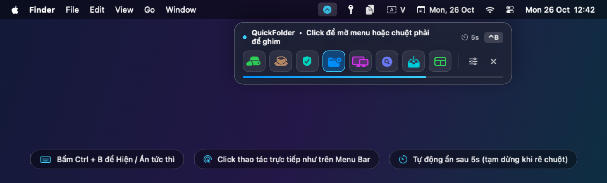
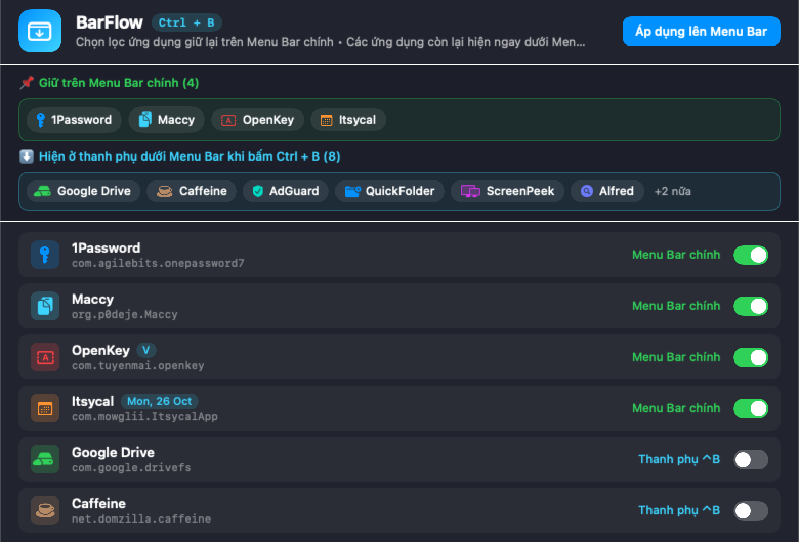

# BarFlow for macOS

**BarFlow** là ứng dụng tiện ích siêu nhẹ cho macOS (lấy cảm hứng từ [Bartender](https://www.macbartender.com/)), giúp **chọn lọc các ứng dụng được phép hiển thị trên thanh Menu Bar chính** và gom toàn bộ các ứng dụng còn lại xuống **thanh nổi kính mờ ngay bên dưới Menu Bar** khi bấm phím tắt **`Ctrl + B`**.

<p align="center">
  
</p>

## 📸 Giao diện Chọn lọc & Quản lý Menu Bar

<p align="center">
  
</p>

## ✨ Tính năng nổi bật

- **Chọn lọc & Ẩn thực sự khỏi Menu Bar chính**:
  - Tự động quét đầy đủ 100% ứng dụng và tiện ích đang chạy trên Menu Bar (bao gồm helper ngầm, tiến trình tray `.prohibited`, multi-icon apps, và các module hệ thống như Wi-Fi, Pin, Spotlight, Bộ gõ bàn phím).
  - Trên **macOS 26 Tahoe / macOS 27 (`MenuBarAgent`)**, `BarFlow` ẩn thực sự các ứng dụng không chọn khỏi thanh Menu Bar gốc (không sinh mũi tên tràn `«`, không tốn chỗ tai thỏ MacBook) và đặt biểu tượng `BarFlow` (`•••`) gọn ở góc trên bên phải sát Control Center.
  - Tự động khôi phục 100% biểu tượng về trạng thái ban đầu khi chọn lại hoặc khi thoát `BarFlow`.
- **Kéo thả sắp xếp thứ tự Trái → Phải trên cả 2 thanh (Phản hồi tức thì `0ms`)**:
  - Sắp xếp tự do thứ tự hiển thị **Trái → Phải** cho cả **Menu Bar chính** (đồng bộ trực tiếp vị trí ưu tiên `TrailingItemPreferredPositions` lên `MenuBarAgent` của macOS) lẫn **Thanh phụ `Ctrl + B`** (cập nhật tức thì `0ms`).
  - Hỗ trợ **kéo thả (Drag & Drop)** trực tiếp trên các chip xem trước, kéo thả trực tiếp các icon ngay bên trong thanh nổi `Ctrl + B`, hoặc bấm nút `◀` / `▶` trên từng dòng ứng dụng.
- **Xem trước 2 vùng trực quan & Chuyển hàng loạt 1 chạm**: Hiển thị trực quan nhóm biểu tượng giữ lại trên **Menu Bar chính** và nhóm chuyển xuống **Thanh phụ `Ctrl + B`**, tích hợp nút **Chuyển toàn bộ xuống phụ** / **Chuyển toàn bộ lên chính** và đồng bộ mượt mà không giật giao diện.
- **Thanh phụ gọn 1 dòng ngay bên phải dưới Menu Bar (`Ctrl + B`)**:
  - Hiện tức thì (`< 5ms`) gọn đúng **1 dòng duy nhất** ở góc trên bên phải màn hình, sát ngay dưới thanh Menu Bar gốc (hỗ trợ đa màn hình & màn hình tai thỏ MacBook).
  - Không cướp tiêu điểm bàn phím (`NSPanel` non-activating) của ứng dụng bạn đang làm việc.
  - **Click chuột trái** vào biểu tượng để mở ngay cửa sổ popover / menu của ứng dụng đó **ngay bên dưới biểu tượng vừa bấm**; **Click chuột phải** để mở tức thì **Menu ứng dụng** (Cài đặt / Preferences, Mở thư mục Cloud, Khoá, **Thoát ứng dụng `⌘Q`**) ngay bên dưới biểu tượng; giữ **`⌥ Option + Click`** để mở tuỳ chọn nhanh của BarFlow.
- **Tuỳ chỉnh phím tắt toàn cục, Mở bằng rê / cuộn chuột & Khởi động cùng macOS**:
  - Cho phép **ghi nhận phím tắt mở thanh phụ tuỳ ý** ngay trong giao diện (mặc định `Ctrl + B`, có thể đổi sang `⌥ + Space`, `⌘ + ⇧ + B`... để tránh trùng `tmux`/Terminal).
  - Hỗ trợ **cuộn chuột 2 ngón trên icon `•••`** để mở/đóng nhanh thanh phụ, kèm tuỳ chọn **rê chuột dừng nhẹ (`0.2s`) trên `•••` để tự mở**.
  - Tích hợp **Khởi động cùng macOS** (`SMAppService.mainApp`) và **Cập nhật tự động 1 chạm trực tiếp từ GitHub Releases** (tự tải gói mới, thay thế `/Applications/BarFlow.app`, gỡ cờ Gatekeeper `xattr` và khởi động lại).
- **Tự động ẩn thông minh & Toggle tức thì**:
  - Tự động ẩn sau khoảng thời gian tuỳ chỉnh (`3s`, `5s`, `8s`, `12s`, `20s`, hoặc thủ công), tự động **tạm dừng đếm ngược** khi con trỏ chuột đang rê bên trong thanh phụ.
  - Bấm lại **`Ctrl + B`** 1 lần nữa (hoặc phím `Esc`, hoặc click ra ngoài) để ẩn thanh phụ ngay lập tức.

## ⌨️ Phím tắt & Thao tác nhanh

| Phím tắt / Thao tác | Chức năng |
| :--- | :--- |
| `Ctrl + B` (`⌃B`) *(hoặc phím tắt tự chọn)* | Hiện thanh ứng dụng phụ ngay dưới Menu Bar (bấm lại 1 lần để ẩn ngay) |
| `Esc` | Đóng nhanh thanh ứng dụng phụ đang mở |
| **Click trái / Cuộn chuột / Rê chuột** trên `•••` | Hiện / Ẩn nhanh thanh ứng dụng phụ không cần rời chuột |
| **Click phải** icon `•••` trên Menu Bar | Mở menu ngữ cảnh nhanh (Chọn lọc ứng dụng, Khởi động cùng macOS, Kiểm tra cập nhật, Thoát) |

---

## 📥 Tải về & Cài đặt nhanh (macOS 14.0+ Universal: Apple Silicon & Intel)

1. Tải bộ cài mới nhất tại trang **[Releases](https://github.com/hungmtuci/BarFlow/releases/latest)**:
   - **`BarFlow-Installer-v1.8.0.dmg`** *(Khuyên dùng)*
   - Hoặc **`BarFlow-v1.8.0-macOS.zip`**
2. Mở file `.dmg`:
   - Kéo `BarFlow.app` thả vào thư mục **`Applications`**, **HOẶC** nhấp chuột phải vào `Cai_Dat_BarFlow.command` → chọn **Open** để tự động cài đặt vào `/Applications` và gỡ cờ cách ly Gatekeeper.
3. Nếu macOS báo ứng dụng chưa công chứng Apple Developer ID khi mở lần đầu trên máy mới, chạy lệnh sau trong Terminal:
   ```bash
   xattr -cr /Applications/BarFlow.app && open /Applications/BarFlow.app
   ```
4. Cấp 2 quyền trong **System Settings → Privacy & Security** (có nút mở nhanh ngay trên thanh hướng dẫn bên trong `BarFlow`):
   - **Accessibility (Trợ năng)**: Để đọc danh sách biểu tượng trên Menu Bar và kích hoạt thao tác click mở menu trong `Ctrl + B`.
   - **Full Disk Access (Truy cập Toàn bộ Đĩa)** *(Bắt buộc trên macOS 26 Tahoe / macOS 27)*: Để macOS cho phép `BarFlow` ghi cấu hình ẩn biểu tượng gốc của `MenuBarAgent`.

---

## 🛠️ Tự biên dịch từ mã nguồn (Build from Source)

Yêu cầu: macOS 14.0+ và Xcode hoặc Command Line Tools (`xcode-select --install`).

```bash
git clone https://github.com/hungmtuci/BarFlow.git
cd BarFlow
chmod +x build_barflow.sh
./build_barflow.sh
```

Sau khi chạy xong `./build_barflow.sh`:
- Ứng dụng được tạo tại `./BarFlow.app`
- Bộ cài `.dmg` và `.zip` được xuất ra tại thư mục `./dist/`

## 📄 Giấy phép

Phát hành theo giấy phép [MIT License](LICENSE).
